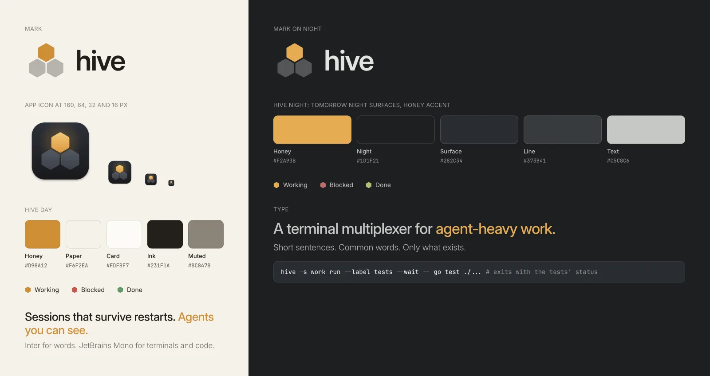

# hive brand

The idea in one shape: **many sessions, one needs you.** hive keeps a lot of
work running side by side, and shows you the one that's waiting.

## Name

- **hive**, in lowercase, everywhere in text. That includes the start of a
  sentence: "hive keeps your sessions."
- **Hive** with a capital H only as the name of the macOS app (`Hive.app`,
  the menu bar, the Dock), because macOS shows app names that way.
- Never "HIVE" or "Hive CLI". The command is `hive`.

## Mark

Three pointy-top honeycomb cells. The top cell is lit honey; the two below
are quiet.

| File | Use |
| --- | --- |
| `.github/assets/brand/mark-on-light.svg` | On paper and other light backgrounds |
| `.github/assets/brand/mark-on-dark.svg` | On night and other dark backgrounds |
| `site/src/lib/Mark.svelte` | The site, which adapts to light and dark |

- **Geometry:** pointy-top hexagons, the cell's corner pointing up. The two
  lower cells sit 60° below the top one, with a small gap. The source of
  truth is `apps/macos/script/icon.swift`, and the SVGs use the same
  numbers.
- **Clear space:** at least half a cell's width on every side.
- **Smallest size:** 16 px. Below that, use only the lit cell.
- **With the name:** the mark, then **hive** in Inter SemiBold at about the
  mark's height, tracking −0.035em. The gap is a third of the mark's width.
- **Don't:**
  - rotate it or use flat-top cells;
  - change the lit cell to any colour but honey, or light more than one
    cell;
  - add outlines, gradients beyond the icon's own, or a bee.

## App icon

The mark on a Tomorrow Night tile, with a soft honey glow behind the lit
cell. `apps/macos/script/icon.swift` draws it, and `bundle.sh` builds
`AppIcon.icns`. Exports: `.github/assets/brand/icon-1024.png` and
`icon-512.png`. It reads at 16 px, so don't simplify it for small sizes.

## Colour

Honey is the only accent. Use it for one thing at a time: focus, the active
tab, a selection, the lit cell, or the words that matter in a headline.
Never fill a large area with it.

**Hive Day** (light)

| Role | Hex |
| --- | --- |
| Honey | `#D98A12` |
| Paper (background) | `#F6F2EA` |
| Card | `#FDFBF7` |
| Ink (text) | `#231F1A` |
| Muted | `#8C8478` |
| Line | Ink at 12% |

**Hive Night** (dark): the Tomorrow Night surfaces of Ghostty and tmux, with
a honey accent

| Role | Hex |
| --- | --- |
| Honey | `#F2A93B` |
| Night (background) | `#1D1F21` |
| Surface (cards, terminal) | `#282C34` |
| Line | `#373B41` |
| Text | `#C5C8C6` |
| Muted | `#969896` |

**Status**: always shown with a small pointy-top hexagon

| State | Day | Night | Behaviour |
| --- | --- | --- | --- |
| Working | Honey `#D98A12` | Honey `#F2A93B` | Pulses slowly |
| Blocked | Coral `#D24E45` | `#CC6666` | Steady, with the word "Blocked" and the reason |
| Done | Sage `#4E9A64` | `#B5BD68` | Steady, until you look |

In dark mode, the terminal uses Ghostty's default theme exactly. Light and
dark follow the system setting.

## Type

- **Inter** for words. Light (300) for body text, Medium (500) for headings,
  SemiBold (600) only for the name next to the mark.
- **JetBrains Mono** for terminals, commands and code. The app uses the
  Nerd Font build, so prompt glyphs render.
- **Landing page:** body about 21 px, line-height 1.3, tracking −0.01em;
  headline about 30 px at 500, tracking −0.02em; text column at most 72
  characters.
- **Docs:** column 576 px; body 15 px, line-height 1.5; h1 28 px; h2 18 px,
  both at 400.

## Shape and motion

- **Corner radii:** pane cards 10 px, code blocks 12 px. Pills are fully
  round (22–28 px).
- **Gaps:** 8 px between pane cards.
- **Easing:** `cubic-bezier(0.4, 0, 0.2, 1)`. Motion is short and quiet:
  no bounces.
- **Truncation:** long titles fade out at the edge. Never end them with
  "…".

## Voice

Write for a reader whose first language isn't English.

- Short sentences, common words, one idea per sentence.
- Say what it does, concretely: "Sessions come back after a restart," not
  "seamless persistence."
- Claim only what exists today. If it's planned, say "planned."
- No hype, no filler: avoid words like "blazing", "revolutionary",
  "effortless", "supercharge" and "unlock".
- Commands in code style, and real ones that work when pasted.

## Imagery

- **Screenshots:** real ones only, from `apps/macos/script/shot.sh`. Never
  generated or edited user interface.
- **Key visual:** `.github/assets/brand/key-visual.webp`, for backgrounds
  such as share cards. It is a sparse honeycomb of pointy-top cells with a
  few lit, on night. Its left side is kept empty for text.
- **Text in images:** set in Inter afterwards (see `site/og/`). Never
  generate it.
- **Honeycombs:** always pointy-top, like the mark.

## Files

| What | Where |
| --- | --- |
| Brand assets | `.github/assets/brand/` |
| App colours | `apps/macos/Sources/HiveApp/Style.swift` |
| Site colours and type | `site/src/app.css` |
| Share cards and this page's sheet | `site/og/` |
