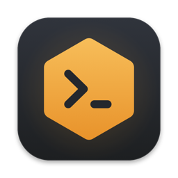
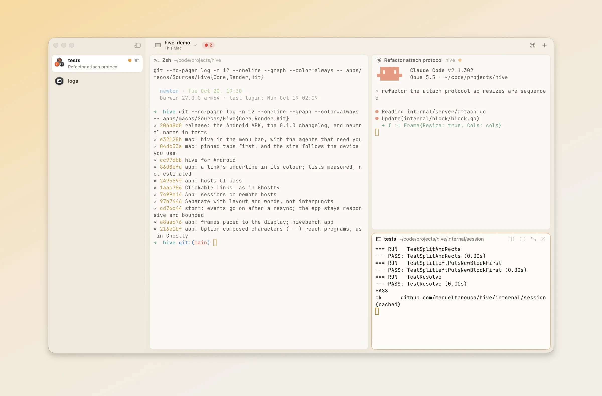

<h1 align="center">
  
  <br>hive
</h1>

<p align="center">
  A terminal multiplexer for agent-heavy work.
  <br>
  Sessions that survive restarts, agents you can see, and an API for everything.
  <br><br>
  <a href="#install">Install</a>
  ·
  <a href="https://manueltarouca.github.io/hive/docs/installation">Docs</a>
  ·
  <a href="#let-your-agent-set-it-up">Agent setup</a>
  ·
  <a href="ARCHITECTURE.md">Architecture</a>
</p>

<p align="center">
  <picture>
    <source media="(prefers-color-scheme: dark)" srcset="site/static/img/hero-dark.webp">
    
  </picture>
</p>

## About

More and more terminal work runs at the same time: coding agents on different
tasks, a dev server, tests. Close the window and the work stops. Restart the
computer and you set it all up again by hand. And an agent can wait an hour
for your answer, in a tab you don't see.

hive is built for this. Your sessions keep running when you close the app,
and they come back after a restart. You see every agent in one place, and the
ones waiting for you come first. Everything you can do in the app, a script or
an agent can do through the same API.

- **Keeps your sessions.** Close the app, stop the server, or reboot. Layouts,
  scrollback and working directories come back.
- **Knows your agents.** Claude Code reports what it is doing and when it
  needs you. After a restart, each agent continues its conversation.
- **Has an API for everything.** The app, the `hive` CLI, your scripts and
  your agents all use one self-describing API.
- **Feels like a normal terminal.** It draws terminals with Ghostty's
  terminal engine. Scrolling and selection are native, with no copy mode.
- **Stays on your computer.** It connects to nothing. There is no account
  and no telemetry.

## Install

hive builds from source. You need Go 1.26 and Zig **0.16** exactly (Ghostty's
build refuses other versions). The Mac app needs macOS 14 and Xcode 16.

```sh
brew install go zig@0.16
git clone https://github.com/manueltarouca/hive && cd hive
make vt       # once: builds Ghostty's terminal library
make build    # ./bin/hive
```

The Mac app carries its own copy of `hive`:

```sh
apps/macos/script/bundle.sh && open apps/macos/build/Hive.app
```

The server and CLI also run on Linux. See
[Installation](https://manueltarouca.github.io/hive/docs/installation) for the
details.

## Let your agent set it up

Paste this into Claude Code, Codex, or any coding agent:

```
Fetch and follow the instructions at
https://manueltarouca.github.io/hive/agent-setup/prompt.md
to set me up with hive.
```

The agent installs hive's skills, builds hive, connects Claude Code, and can
move your tmux sessions over one window at a time. In Claude Code you can
install the skills yourself:

```sh
claude plugin marketplace add manueltarouca/hive
claude plugin install hive@hive
```

## Quick start

```sh
hive new work --cwd ~/src/app                 # a session; starts the server if needed
hive -s work split --split below -- htop      # a pane beside the current one
hive -s work run --label tests --wait -- go test ./...   # exits with the tests' status
hive -b tests capture --trim                  # screen and scrollback, as text
hive ls                                       # every session
```

Inside a hive terminal, commands act on that terminal's own session and pane,
so you rarely need `-s` or `-b`.

## Agents

```sh
hive agent install claude     # add hive's hooks to Claude Code
hive agents                   # every agent, the ones waiting for you first
```

```
STATE    HARNESS  SESSION      BLOCK   DIR          SINCE   MESSAGE
blocked  claude   api-gateway  …a29f3  ~/src/api    now     Claude needs your permission to use Bash
working  claude   hive-demo    agent   ~/src/hive   2m ago
```

`hive agent uninstall claude` removes the hooks again. After a restart, each
agent pane runs its harness's resume command with the latest session: `claude --resume`, `codex resume`, `opencode -s`,
`gemini --resume` or `grok --resume`.
[More about agents](https://manueltarouca.github.io/hive/docs/agents).

## Scripting

The CLI wraps a JSON API on a Unix socket, and the server describes it:

```sh
hive api list                                # every method
hive api describe session.new_split          # its arguments, as JSON Schema
hive events -s work --json                   # a live stream of what happens
curl --unix-socket "$HIVE_SERVER" http://hive/v1/call \
  -H 'content-type: application/json' -d '{"method":"session.list"}'
```

Command names, method names and exit codes don't change between versions, so
scripts keep working. See [the CLI](https://manueltarouca.github.io/hive/docs/cli)
and [the server API](https://manueltarouca.github.io/hive/docs/api).

## Restarts

A stopped server, a crash or a reboot ends the programs, but not the
sessions. The next `hive` command brings back every session with its layout
and labels. Each pane gets its screen and scrollback, a `── restored ──` line,
then a shell in its last directory, or its agent, resumed. Other programs are
not run again. State lives in `~/.local/state/hive`.

## How it works

One Go program, `hive`, is both the server and the CLI. The server owns
every terminal: a PTY plus a headless copy of Ghostty's terminal engine
([libghostty-vt](https://github.com/ghostty-org/ghostty)). It saves layouts
and terminal snapshots to disk. The Mac app is native (Swift, AppKit, Metal).
It mirrors each terminal through an ordered byte stream and draws it on the
GPU. [ARCHITECTURE.md](ARCHITECTURE.md) has the details and the decisions.

## Status

hive is young. The server, CLI and Mac app work, and Claude Code has the
deepest integration. Planned next: Lua configuration, then remote machines.

## Thanks

hive stands on [Ghostty](https://ghostty.org)'s terminal engine, and uses
[JetBrains Mono](https://www.jetbrains.com/lp/mono/) and
[Inter](https://rsms.me/inter/).

## License

[MIT](LICENSE)
